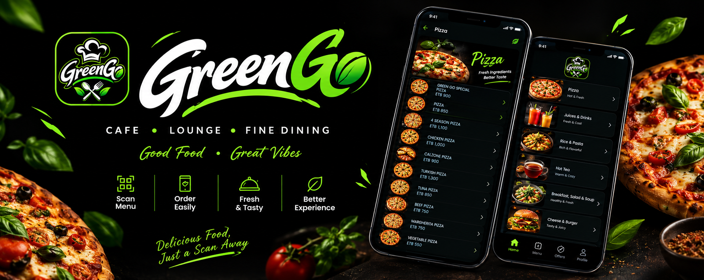

# 🍃 GreenGo – Digital Restaurant Menu

<p align="center">
  
</p>

<p align="center">
  <strong>A modern QR-based digital menu experience for restaurants.</strong>
  <br />
  Browse menus, explore special offers, and manage restaurant content — all in one place.
</p>

<p align="center">
  <a href="https://greengo-menu.netlify.app/">
    
  </a>
  <a href="https://github.com/Faniel-7/GreenGo-Menu-App">
    
  </a>
  
  
</p>

---

## 📖 Table of Contents

- [🍃 GreenGo – Digital Restaurant Menu](#-greengo--digital-restaurant-menu)
  - [📖 Table of Contents](#-table-of-contents)
  - [🍃 About GreenGo](#-about-greengo)
    - [🎯 Project Goals](#-project-goals)
  - [✨ Key Features](#-key-features)
  - [📱 Customer Experience](#-customer-experience)
    - [How It Works](#how-it-works)
  - [🛠️ Admin Dashboard](#️-admin-dashboard)
    - [Category Management](#category-management)
    - [Menu Item Management](#menu-item-management)
    - [Administration \& Access](#administration--access)
  - [🎉 Special Offers](#-special-offers)
    - [Available Offer Management](#available-offer-management)
  - [📸 Screenshots](#-screenshots)
    - [🖥️ Desktop Experience](#️-desktop-experience)
    - [📲 Mobile Experience](#-mobile-experience)
  - [💻 Technology Stack](#-technology-stack)
  - [📂 Project Structure](#-project-structure)
  - [🚀 Getting Started](#-getting-started)
  - [📥 Installation](#-installation)
  - [▶️ Running the Project](#️-running-the-project)
  - [🛣️ Future Improvements](#️-future-improvements)
  - [🤝 Contributing](#-contributing)
  - [👨‍💻 About the Developer](#-about-the-developer)
  - [📄 License](#-license)

---

## 🍃 About GreenGo

**GreenGo** is a digital restaurant menu application designed to make menu browsing easier for customers and menu management more convenient for restaurant administrators.

Instead of relying only on printed menus, restaurants can provide customers with a QR code that opens their digital menu directly in a mobile browser. Customers can explore food and drink categories, view menu items and prices, and discover current promotions without installing an application.

GreenGo also includes an administration dashboard that allows authorized administrators to manage menu categories, food items, prices, images, and special offers.

The project is built with **React Native, Expo, and Supabase**, with support for both Android and Web.

### 🎯 Project Goals

- Make restaurant menus accessible through QR codes.
- Provide customers with a clean and convenient browsing experience.
- Make menu updates easier without repeatedly printing menus.
- Give administrators control over menu content and promotions.
- Provide a responsive experience across mobile and desktop screens.

---

## ✨ Key Features

| Feature | Description |
|---|---|
| 📱 QR Menu Access | Customers can scan a QR code and open the menu in their mobile browser. |
| 🍽️ Menu Categories | Browse food and drink categories. |
| 🧾 Menu Details | View menu items, descriptions, and prices. |
| 💰 ETB Pricing | Display menu prices in Ethiopian Birr (ETB). |
| 🎨 Visual Menu Design | Category-based poster imagery and a restaurant-focused interface. |
| 🎉 Special Offers | Explore available discounts, happy hours, and promotions. |
| 🔐 Admin Authentication | Protect administrative access through Supabase Auth. |
| ⚙️ Menu Management | Create, edit, hide, show, and delete categories and manage menu items. |
| 🗓️ Offer Scheduling | Set offer start and end dates and times. |
| 🎯 Offer Targeting | Select the relevant customer groups and menu items for offers. |
| 🌐 Web & Android | Built to support web browsers and Android devices. |

---

## 📱 Customer Experience

GreenGo provides customers with a straightforward way to explore a restaurant's menu.

### How It Works

1. Scan the restaurant's QR code.
2. Open the digital menu in a mobile browser.
3. Browse available food and drink categories.
4. Explore menu items and their prices.
5. View special offers and promotion details.

**No application installation is required to browse the web menu.**

> GreenGo currently focuses on digital menu browsing and offer discovery. Online ordering, cart management, and payment processing are not included.

---

## 🛠️ Admin Dashboard

GreenGo includes an administration dashboard for managing restaurant menu content.

### Category Management
- Create new menu categories.
- Edit existing category information.
- Hide or show categories.
- Delete categories.

### Menu Item Management
- Add new food and drink items.
- Update item information and prices.
- Manage item images.
- Organize items within the menu.

### Administration & Access
- Protected administrator login.
- Manage menu content through the dashboard.
- Keep customer-facing menu information up to date.

---

## 🎉 Special Offers

The Special Offers feature allows administrators to create and manage restaurant promotions.

### Available Offer Management

- Create, edit, and delete offers.
- Configure discounts, happy hours, and promotions.
- Set offer start and end dates.
- Set offer start and end times.
- Choose the relevant target groups.
- Select the menu items associated with an offer.
- Display offer information on the customer-facing menu.

This gives restaurants more flexibility when managing promotions and communicating them to customers.

---

## 📸 Screenshots

Explore the GreenGo interface on desktop and mobile devices.

### 🖥️ Desktop Experience

<details>
<summary><strong>View Desktop Screenshots</strong></summary>

<table>
  <tr>
    <td><a href="screenshots/1.png"></a></td>
    <td><a href="screenshots/3.png"></a></td>
    <td><a href="screenshots/5.png"></a></td>
    <td><a href="screenshots/7.png"></a></td>
    <td><a href="screenshots/10.png"></a></td>
    <td><a href="screenshots/14.png"></a></td>
    <td><a href="screenshots/16.png"></a></td>
    <td><a href="screenshots/20.png"></a></td>
    <td><a href="screenshots/21.png"></a></td>
  </tr>
</table>

</details>

### 📲 Mobile Experience

<details>
<summary><strong>View Mobile Screenshots</strong></summary>

<table>
  <tr>
    <td><a href="screenshots/2.png"></a></td>
    <td><a href="screenshots/4.png"></a></td>
    <td><a href="screenshots/6.png"></a></td>
    <td><a href="screenshots/8.png"></a></td>
    <td><a href="screenshots/9.png"></a></td>
    <td><a href="screenshots/11.png"></a></td>
    <td><a href="screenshots/12.png"></a></td>
    <td><a href="screenshots/13.png"></a></td>
    <td><a href="screenshots/15.png"></a></td>
    <td><a href="screenshots/17.png"></a></td>
    <td><a href="screenshots/18.png"></a></td>
    <td><a href="screenshots/19.png"></a></td>
  </tr>
</table>

</details>

---

## 💻 Technology Stack

GreenGo uses the following technologies:

| Technology | Purpose |
|---|---|
| [React Native](https://reactnative.dev/) | Application development |
| [Expo](https://expo.dev/) | Development and application tooling |
| [Expo Router](https://docs.expo.dev/router/introduction/) | File-based navigation |
| [React Native Web](https://necolas.github.io/react-native-web/) | Web support |
| [Supabase](https://supabase.com/) | Database and authentication |
| [JavaScript](https://developer.mozilla.org/en-US/docs/Web/JavaScript) | Application logic |
| [TypeScript](https://www.typescriptlang.org/) | Typed application code |
| [Netlify](https://www.netlify.com/) | Web deployment and hosting |

---

## 📂 Project Structure

The application is organized around Expo Router routes and reusable components.

```text
GreenGo/
│
├── assets/
│   ├── images/
│   └── ...
│
├── src/
│   ├── app/
│   │   ├── admin/
│   │   │   ├── offers/
│   │   │   ├── add-item.jsx
│   │   │   ├── categories.jsx
│   │   │   ├── category.jsx
│   │   │   ├── dashboard.jsx
│   │   │   ├── login.jsx
│   │   │   ├── offers.jsx
│   │   │   └── settings.jsx
│   │   │
│   │   ├── details/
│   │   ├── item/
│   │   ├── menu/
│   │   │   ├── offer/
│   │   │   ├── breakfast.tsx
│   │   │   ├── burger-and-sandwich.tsx
│   │   │   ├── chinese.tsx
│   │   │   ├── hot-drinks.tsx
│   │   │   ├── juice-and-soft-drinks.tsx
│   │   │   ├── offers.tsx
│   │   │   ├── pizza.tsx
│   │   │   ├── rice-pasta-wrap.tsx
│   │   │   └── salads-and-soup.tsx
│   │   │
│   │   ├── _layout.tsx
│   │   └── index.tsx
│   │
│   ├── components/
│   │   ├── admin/
│   │   └── ...
│   │
│   ├── constants/
│   ├── data/
│   ├── hooks/
│   ├── lib/
│   ├── screens/
│   └── utils/
│
├── screenshots/
├── package.json
└── README.md
```

---

## 🚀 Getting Started

To run GreenGo locally, make sure you have the following installed:

- [Node.js](https://nodejs.org/)
- npm (included with Node.js)
- [Git](https://git-scm.com/)
- A code editor such as [Visual Studio Code](https://code.visualstudio.com/)

You will also need access to the Supabase project configuration used by the application.

## 📥 Installation

**1. Clone the repository**

```bash
git clone https://github.com/Faniel-7/GreenGo-Menu-App.git
```

**2. Navigate to the application directory**

```bash
cd GreenGo-Menu-App/GreenGo
```

**3. Install dependencies**

```bash
npm install
```

**4. Configure Supabase**

Check the Supabase client configuration in the `src/lib/` directory. Provide your Supabase project URL and the appropriate public client key using the configuration format expected by the application.

Do not expose or commit your Supabase service-role key or other private credentials.

## ▶️ Running the Project

Start the Expo development server:

```bash
npx expo start
```

Run the web version:

```bash
npx expo start --web
```

Run on Android:

```bash
npx expo start --android
```

Run the lint script:

```bash
npm run lint
```

---

## 🛣️ Future Improvements

Possible directions for future development include:

- 🏪 Multi-restaurant support.
- 🛒 Online ordering and cart functionality.
- 💳 Online payment integration.
- 📊 Restaurant analytics and menu performance insights.
- 🌍 Additional language support.
- 🔔 Customer notifications for new promotions.

These are potential future enhancements and are not currently presented as existing features.

---

## 🤝 Contributing

Contributions, suggestions, and feedback are welcome.

If you would like to contribute:

1. Fork the repository.
2. Create a new branch.
3. Make your changes.
4. Commit your changes.
5. Open a pull request.

For major changes, please open an issue first to discuss what you would like to improve.

---

## 👨‍💻 About the Developer

**Developed by Faniel Negasi**

Computer Science student and software developer interested in building practical digital solutions.

<p align="center">
  <a href="https://github.com/Faniel-7">
    
  </a>
  <a href="https://linkedin.com/in/faniel-negasi">
    
  </a>
  <a href="mailto:fanielnegasi00@gmail.com">
    
  </a>
</p>

---

## 📄 License

This project is licensed under the **MIT License**.

You are free to use, modify, and distribute this project in accordance with the terms of the license. See the [LICENSE](LICENSE) file for details.

---

<p align="center">
  <strong>🍃 GreenGo — A better way to explore restaurant menus.</strong>
  <br />
  <sub>Designed and developed with care.</sub>
</p>